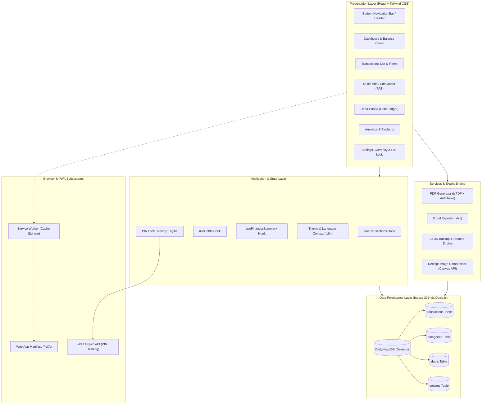
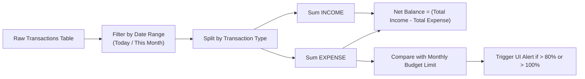
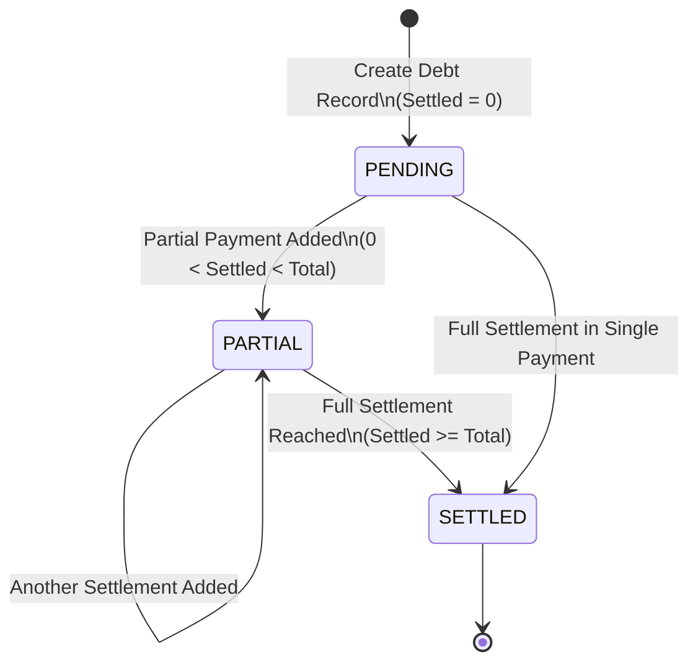
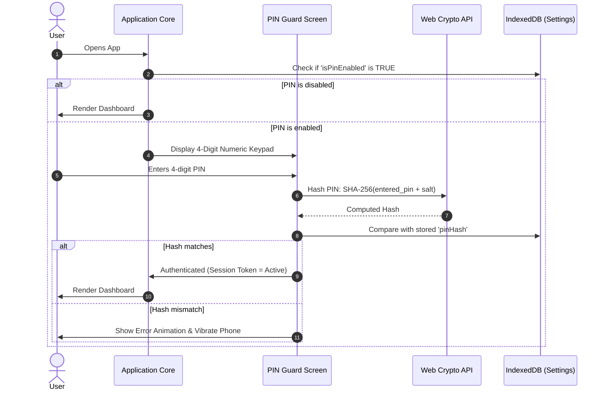

# System Architecture Document: Daily Hisab (দৈনিক হিসাব খাতা)

> **Application Name**: Daily Hisab - Personal & Small Business Finance PWA  
> **Target Platforms**: Web, Mobile (PWA for Android & iOS), Desktop Browsers  
> **Architecture Pattern**: Offline-First Single Page Application (SPA / PWA) with Repository Pattern & Reactive Local Database  
> **Source Specification**: Based on [`prompt.md`](file:///c:/Users/USER/Documents/prscription%20app/prompt.md)

---

## 1. System Overview & Core Principles

Daily Hisab is engineered as an **Offline-First, Privacy-Centric, Zero-Latency Financial Management PWA**. All critical user data (financial transactions, debts, categories, and settings) resides exclusively on the client device inside **IndexedDB**, guaranteeing instantaneous operations without server dependencies or mandatory network connectivity.

```
┌─────────────────────────────────────────────────────────────┐
│                    Client Browser / PWA                     │
│ ┌─────────────────┐  ┌──────────────────┐  ┌──────────────┐ │
│ │  Presentation   │  │ State & Business │  │  Repository  │ │
│ │  (React + UI)   │◄─┤   (Hooks/Core)   │◄─┤ (Dexie DB)   │ │
│ └─────────────────┘  └──────────────────┘  └──────┬───────┘ │
│                                                   │         │
│               IndexedDB (Local Engine) ◄──────────┘         │
└─────────────────────────────────────────────────────────────┘
```

### Core Architecture Pillars:
1. **Offline-First Resilience**: 100% operational offline. Uses Service Workers and Cache API to cache static assets, and IndexedDB for dynamic persistent data.
2. **Zero Latency**: Reads and writes occur locally in milliseconds. Reactive UI auto-updates using Dexie live queries.
3. **Data Sovereignty & Privacy**: Financial records never leave the user's device unless explicitly exported by the user (JSON/PDF/Excel).
4. **Bilingual Localization (i18n)**: Native Bengali (বাংলা) and English support with instant toggle.
5. **Mobile-First Ergonomics**: Optimized for 1-hand touch operations on mobile screens with bottom navigation and quick numeric input chips.

---

## 2. High-Level Architecture Diagram



---

## 3. Technology Stack Breakdown & Rationale

| Category | Technology Chosen | Rationale & Advantage |
| :--- | :--- | :--- |
| **Framework** | **React 18+ (Vite / Next.js)** | High performance, modular component architecture, robust TypeScript support. |
| **Language** | **TypeScript 5+** | Strict type safety for financial calculations, preventing null-reference and schema errors. |
| **Styling & Icons** | **Tailwind CSS + Lucide React** | Utility-first rapid styling, dark mode support via CSS variables, clean vector iconography. |
| **Animations** | **Framer Motion** | Silky-smooth modal transitions, sheet drawers, and number increment animations. |
| **Local Database** | **Dexie.js (IndexedDB wrapper)** | Indexed queries, transactions, handles large BLOBs/images, 50MB+ capacity, reactive bindings (`useLiveQuery`). |
| **Charts & Graphs** | **Recharts** | Declarative, SVG-based responsive charts with smooth tooltips and animations. |
| **Export Engines** | **jsPDF, jspdf-autotable, xlsx** | Client-side zero-server generation of printable Bengali/English PDF receipts and Excel sheets. |
| **PWA Engine** | **Vite PWA / Workbox** | Automated service worker lifecycle, offline asset caching, installable home screen prompt. |

---

## 4. Scalable Project Directory Structure

```
daily-hisab/
├── public/
│   ├── favicon.ico
│   ├── manifest.json              # PWA manifest
│   ├── icons/                     # App icons (192x192, 512x512)
│   └── fonts/                     # Hind Siliguri & Inter fonts
├── src/
│   ├── assets/                    # Static vectors & brand assets
│   ├── components/
│   │   ├── common/                # Reusable Atoms: Button, Card, Input, Modal, Badge
│   │   ├── layout/                # Header, BottomNav, Sidebar (desktop), Container
│   │   ├── dashboard/             # BalanceCard, QuickStats, RecentTransactions
│   │   ├── transactions/          # TransactionItem, TransactionList, FilterBar
│   │   ├── transaction-modal/     # QuickAddModal, AmountKeypad, CategoryPicker
│   │   ├── debts/                 # DebtCard, DebtSettlementModal, DebtList
│   │   ├── reports/               # ExpensePieChart, TrendBarChart, SummaryTable
│   │   └── settings/              # PinLockModal, CurrencyPicker, LanguageToggle
│   ├── db/
│   │   ├── db.ts                  # Dexie instance & schema migrations
│   │   ├── seed.ts                # Initial default categories in BN/EN
│   │   └── repositories/          # Type-safe query helper functions
│   │       ├── transaction.repo.ts
│   │       ├── debt.repo.ts
│   │       └── category.repo.ts
│   ├── hooks/                     # Custom React Hooks
│   │   ├── useTransactions.ts     # Live-query transaction subscription
│   │   ├── useDebts.ts            # Live-query debts subscription
│   │   ├── useCategories.ts       # Category list & management
│   │   ├── useFinancialSummary.ts # Balance, today/monthly aggregation calculations
│   │   ├── usePinLock.ts          # PIN verification and app locking
│   │   └── useLanguage.ts         # i18n hook
│   ├── lib/
│   │   ├── calculations.ts        # Pure calculation & aggregation utilities
│   │   ├── formatters.ts          # Currency, Bengali numerals, and date formats
│   │   ├── imageCompressor.ts     # Canvas-based client image downscaling
│   │   ├── pdfGenerator.ts        # jsPDF layout templates
│   │   ├── excelExporter.ts       # SheetJS data table serializer
│   │   └── crypto.ts              # SHA-256 PIN hashing via Web Crypto API
│   ├── locales/
│   │   ├── bn.json                # Bengali translation dictionary
│   │   └── en.json                # English translation dictionary
│   ├── types/
│   │   ├── database.types.ts      # IndexedDB Table interfaces
│   │   └── models.ts              # Domain business types
│   ├── App.tsx                    # Route coordinator & App Lock barrier
│   ├── index.css                  # Tailwind directives & typography
│   └── main.tsx                   # React root entry
├── vite.config.ts                 # Vite + PWA build configuration
├── tailwind.config.js             # Tailwind design tokens & font settings
└── tsconfig.json                  # Strict TypeScript configuration
```

---

## 5. Database Schema & Data Modeling (IndexedDB via Dexie.js)

### 5.1. Database Schema Definition

```typescript
import Dexie, { Table } from 'dexie';

export class DailyHisabDatabase extends Dexie {
  transactions!: Table<ITransaction, string>;
  categories!: Table<ICategory, string>;
  debts!: Table<IDebtRecord, string>;
  settings!: Table<ISettingsRecord, string>;

  constructor() {
    super('DailyHisabDB');

    // Define schemas and indexed keys
    this.version(1).stores({
      transactions: 'id, type, amount, categoryId, paymentMethod, date, createdAt',
      categories: 'id, type, nameEn, nameBn',
      debts: 'id, type, personName, status, dueDate, createdAt',
      settings: 'key',
    });
  }
}

export const db = new DailyHisabDatabase();
```

### 5.2. Entity Models & Interfaces

```typescript
// --- 1. Transactions ---
export type TransactionType = 'INCOME' | 'EXPENSE' | 'TRANSFER';
export type PaymentMethod = 'CASH' | 'BKASH' | 'NAGAD' | 'ROCKET' | 'BANK' | 'OTHER';

export interface ITransaction {
  id: string;                         // UUID v4
  type: TransactionType;              // Expense / Income / Transfer
  amount: number;                     // Always positive float
  categoryId: string;                 // FK -> categories.id
  paymentMethod: PaymentMethod;
  date: string;                       // ISO 8601 string: "2026-11-17T14:30:00.000Z"
  note?: string;                      // Optional text
  receiptImage?: string;              // Compressed Base64 WebP/JPEG data URL
  createdAt: number;                  // Unix Epoch timestamp
  updatedAt: number;
}

// --- 2. Categories ---
export interface ICategory {
  id: string;
  nameEn: string;
  nameBn: string;
  type: 'INCOME' | 'EXPENSE';
  icon: string;                       // Lucide icon identifier (e.g., "Utensils", "Bus")
  color: string;                      // Hex code (e.g., "#10B981")
  monthlyBudget?: number;             // Optional category budget cap
  isCustom?: boolean;                 // Flag to protect default system categories
}

// --- 3. Dena-Paona (Debts / Credit Ledger) ---
export type DebtType = 'RECEIVABLE' | 'PAYABLE'; // পাবো (Asset) vs দিবো (Liability)
export type DebtStatus = 'PENDING' | 'PARTIAL' | 'SETTLED';

export interface IDebtSettlement {
  id: string;
  amount: number;
  date: string;
  paymentMethod: PaymentMethod;
  note?: string;
}

export interface IDebtRecord {
  id: string;
  personName: string;
  phoneNumber?: string;
  type: DebtType;
  totalAmount: number;
  settledAmount: number;              // Sum of all settlements
  dueDate?: string;                   // Optional due date string
  notes?: string;
  status: DebtStatus;
  settlements: IDebtSettlement[];     // Sub-ledger of historical payments
  createdAt: number;
  updatedAt: number;
}

// --- 4. User Configuration & App State ---
export interface ISettingsRecord {
  key: 'user_preferences';
  language: 'bn' | 'en';
  currencySymbol: string;             // '৳', '$', '€', '₹'
  currencyCode: string;               // 'BDT', 'USD', etc.
  monthlyBudgetLimit: number;
  theme: 'light' | 'dark' | 'system';
  isPinEnabled: boolean;
  pinHash?: string;                   // Salted PBKDF2 or SHA-256 hash string
}
```

---

## 6. Core Business Logic & Engine Pipelines

### 6.1. Financial Aggregation Pipeline



### 6.2. Debt Settlement State Machine



### 6.3. Receipt Image Storage Pipeline
To avoid bloating IndexedDB with multi-megabyte mobile photos:
1. User captures or selects image from camera/gallery.
2. Image is loaded into an HTML5 `<canvas>` element in memory.
3. Resized dynamically to maximum `800px` width/height while maintaining aspect ratio.
4. Compressed to `image/webp` (or `image/jpeg` fallback) at 70% quality (~40KB - 80KB size).
5. Stored safely as Base64 string in `receiptImage` field.

---

## 7. Security, PIN Lock & Privacy Architecture



---

## 8. Export & Report Generation Architecture

### 8.1. PDF Generation Architecture (`jsPDF` + `AutoTable`)
- **Theme**: Clean corporate financial statement.
- **Header**: Organization/User name, Report Period (e.g., "০১ নভেম্বর ২০২৬ - ৩০ নভেম্বর ২০২৬"), Generation Date.
- **Summary Section**: Metric boxes for Total Income, Total Expenses, Net Savings, Budget Utilization rate.
- **Tabular Data**:
  - Columns: Date | Type | Category | Note | Payment Method | Amount.
  - Alternating row fills with colored badges (Green for Income, Red for Expense).
- **Bangla Support**: Embedding base64 UTF-8 font for Bengali character rendering (or bilingual phonetic transliteration).

### 8.2. Backup & Restore Data Envelope
When backing up, the app generates a timestamped `.json` file containing:
```json
{
  "version": 1,
  "exportedAt": "2026-11-17T17:00:00.000Z",
  "appName": "DailyHisab",
  "data": {
    "transactions": [...],
    "categories": [...],
    "debts": [...],
    "settings": {...}
  },
  "checksum": "a3f89e..."
}
```
During restore, the schema verifies the checksum and array integrity before bulk-inserting into IndexedDB via a safe database transaction.

---

## 9. Progressive Web App (PWA) & Offline Lifecycle

1. **Service Worker Strategy**:
   - `CacheFirst` for static production bundles (`.js`, `.css`, fonts, icons).
   - Instant load even under complete airplane mode.
2. **Web App Manifest**:
   - `display: standalone` removes browser URL bar, giving true native mobile look.
   - `theme_color`: `#059669` (Emerald Green) matches mobile status bar.
   - `orientation: portrait-primary` for mobile layout stability.
3. **Storage Quota Resilience**:
   - Uses `navigator.storage.persist()` API to request persistent storage from the browser, preventing automatic OS cache clearing during low-disk situations.

---

## 10. Implementation Roadmap & Milestones

```
Phase 1: Foundation (Vite + Tailwind + Dexie DB + Types)
    │
    ▼
Phase 2: Core Engine (Transactions CRUD + Category Presets)
    │
    ▼
Phase 3: Financial Engine (Dynamic Balance, Budget Alerts, Filters)
    │
    ▼
Phase 4: Debt Module (Dena-Paona / Loan Tracking & Settlements)
    │
    ▼
Phase 5: Analytics & Visuals (Recharts Donut/Bar + Date Aggregation)
    │
    ▼
Phase 6: Exporters & Security (PDF/Excel Export, Backup/Restore, PIN Lock)
    │
    ▼
Phase 7: PWA, i18n & Final Polish (Service Worker, Bangla Fonts, Responsiveness)
    │
    ▼
Phase 8: Commercial Grade Upgrades (Monetization & SaaS Ready)
  ├── Step 1: Multi-Device Cloud Sync + Google / Email Auth (Supabase RLS)
  ├── Step 2: Multiple Cashbooks / Khatas (Personal, Store, Family Separation)
  ├── Step 3: Bangla SMS & WhatsApp Debt Reminders + Thermal POS Cash Memo
  ├── Step 4: AI Voice Expense Entry (Spoken Bengali NLP Parser)
  └── Step 5: Customer & Supplier Directory + Party Ledger & Statement Export
```

This architecture provides a complete, scalable, and secure blueprint for implementing the **Daily Hisab** application.
